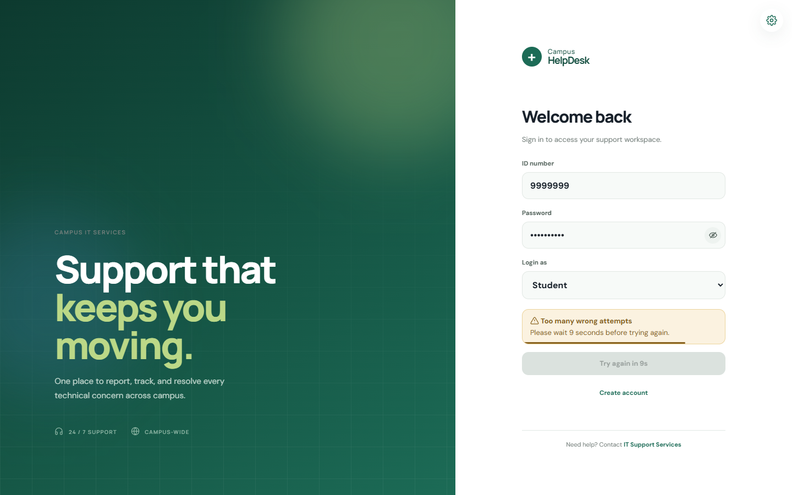
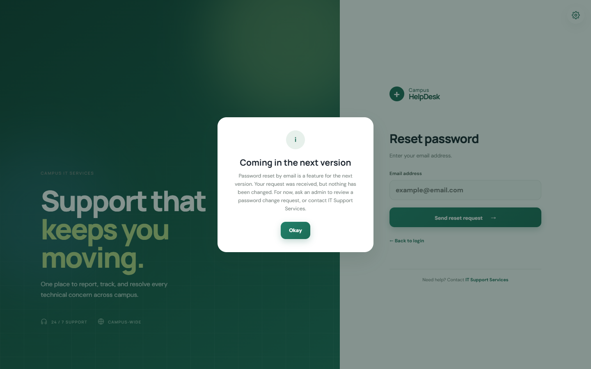
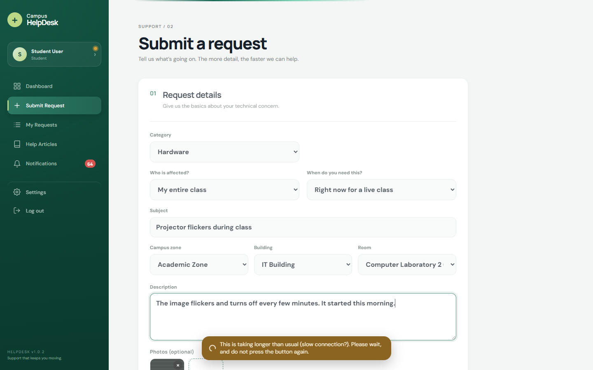
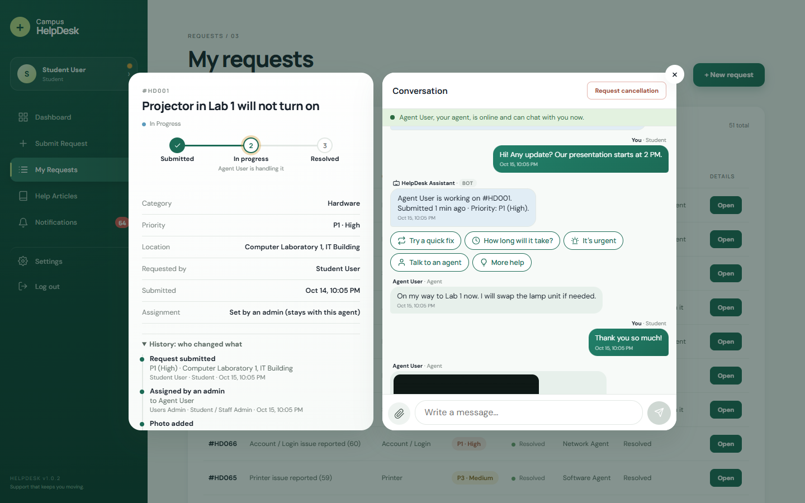
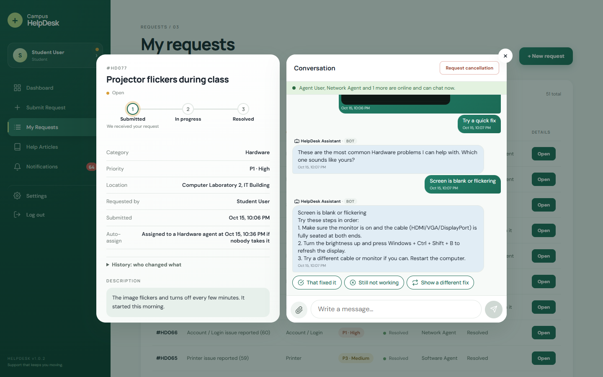
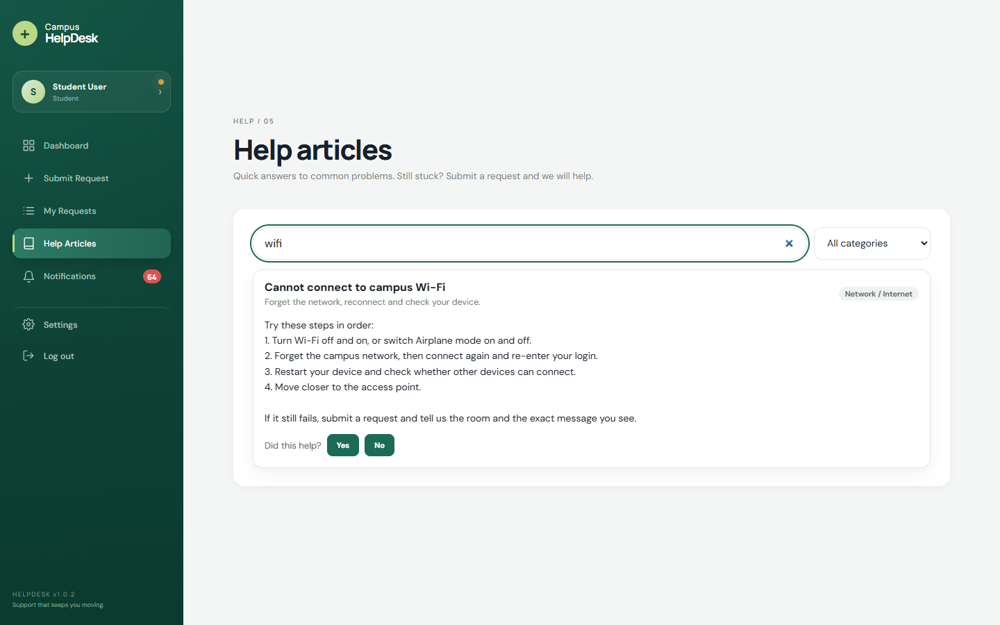
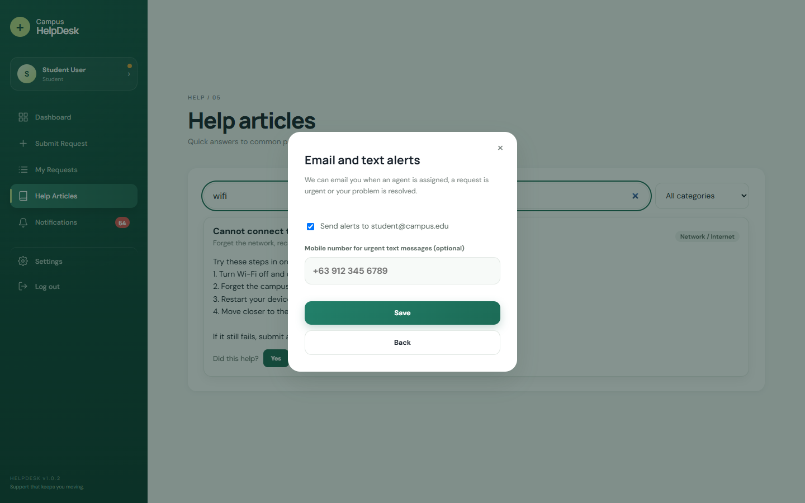
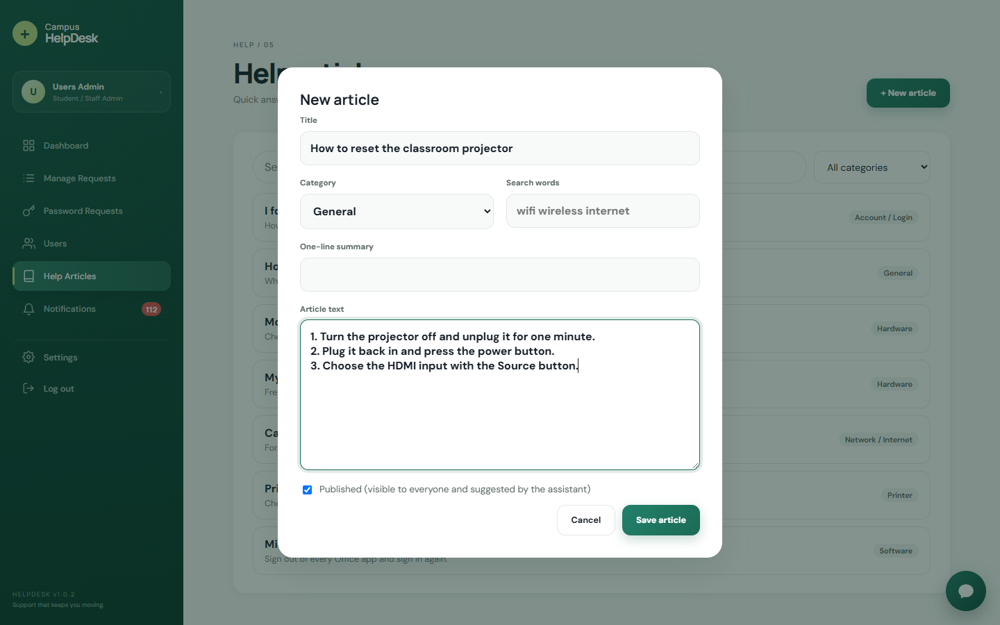

# Campus HelpDesk

A role-based IT support desk for a campus, built with **React + Vite** and a small **Express + MySQL** API. Students and university staff report problems, agents fix them, admins assign and supervise, and the super admin watches the numbers. A guided chatbot, automatic priorities, automatic assignment, photos, help articles, live updates and daily backups are built in.

It ships in two forms:

1. **Full app**: React frontend + Express API + MySQL database (real persistence). Start it with one double-click (`start.bat`) or `npm start`.
2. **Presentation build**: a single self-contained `presentation/index.html` that runs an older version of the UI in the browser with `localStorage` instead of a database. No backend, no build step.

---

## Table of contents

- [Features](#features)
- [Screenshots](#screenshots)
- [How the smart parts work](#how-the-smart-parts-work)
  - [HelpDesk Assistant (ticket chatbot)](#helpdesk-assistant-ticket-chatbot)
  - [Smart intake and automatic priority](#smart-intake-and-automatic-priority)
  - [Auto-assignment with a 30-minute expiry](#auto-assignment-with-a-30-minute-expiry)
  - [Photos, help articles, history, alerts and backups](#photos-help-articles-history-alerts-and-backups)
  - [Loading feedback and double-click protection](#loading-feedback-and-double-click-protection)
  - [Sign-in safety](#sign-in-safety)
- [Security and governance](#security-and-governance)
- [Tech stack](#tech-stack)
- [Project structure](#project-structure)
- [Getting started](#getting-started)
- [Putting it online for free](#putting-it-online-for-free)
- [Demo accounts](#demo-accounts)
- [API reference](#api-reference)
- [Database schema](#database-schema)
- [Presentation build (no database)](#presentation-build-no-database)
- [Available scripts](#available-scripts)
- [Backup and recovery](#backup-and-recovery)
- [Security notes](#security-notes)
- [License](#license)

---

## Features

**Everyone**
- **Role-based access**: Student, University Staff, Agent, Admin, Super Admin and a read-only Report Viewer, each with its own menu and dashboard.
- **Secure sign-in**: hashed passwords, session tokens, a 10-second pause after 5 wrong attempts, account lockout after 10, and optional two-step verification (authenticator app).
- **Notifications** that arrive **live** (no waiting for a refresh), with an unread badge, pop-up banners and optional **email / text alerts**.
- **Help articles**: a searchable page of fixes that admins write and the chatbot suggests.
- **Settings**: theme (light, dark or follow the device), animations, mute and volume, saved in the browser, plus an About dialog.
- **Sound effects** for sign-in, sign-up, messages and notifications.
- **Works on every screen**: sidebar on desktop, icon rail on tablets, bottom tab bar on phones.
- **Feedback while it works**: a progress bar, "Working on it" notes and locked buttons, so a slow connection never makes anyone click twice.

**Students and University Staff**
- Submit a request with a category, two quick questions (*who is affected?*, *when do you need it?*), a **Campus zone > Building > Room** picker and up to 3 photos. The priority (P1 to P4) is worked out automatically.
- Track every request with a live progress tracker (Submitted, In progress, Resolved), the assigned agent and **who changed what** on the ticket.
- Talk to the **HelpDesk Assistant** (multiple-choice buttons, understands typed English and Tagalog) and, once an agent joins, to the support team in the same conversation.
- Cannot cancel directly: they send a **cancellation request** that an admin accepts or rejects.
- If a resolved problem comes back they can **reopen** the ticket (after a warning, with a reason, up to 3 times, until it closes for good after 3 days).
- Rate the support (1 to 5 stars) after a resolution.

**Agents**
- A queue with **recommendations**: tickets matching the agent's skills come first with a "Recommended" badge; resolving one outside their skills asks for confirmation ("at your own risk").
- Tickets that nobody picks up are **assigned automatically** to the agent whose skills match, and move on if they are not resolved in 30 minutes.
- Ticket conversations (with photos) and a Facebook-style **chat dock** to message admins and other agents.

**Admins**
- **Manage requests**: review all tickets, **assign** an agent (the dialog shows who is online and how many tickets each agent has; skill matches first) and answer **cancellation requests**. A ticket an admin assigns is never moved by the automatic assignment.
- **Users**: browse accounts, set **agent skills**, switch someone between University Staff and Agent.
- **Password requests**: approve or decline password-change requests.
- **Help articles**: write, edit, hide and delete the articles (with views and "was this helpful" counts).

**Super admin**
- A **Super Admin Panel**: archive old tickets (JSON plus a tidy CSV spreadsheet, never a hard delete), download or create **database backups**, and manage who is an admin or read-only Report Viewer (lockout and two-step-verification overrides).
- A **dashboard** with a **Monthly KPI Scorecard**: 16 IT performance metrics (average handling time, first response time, SLA compliance, first-time fix rate, reopen rate, backlog, customer satisfaction and more) of which the super admin picks the ones that matter each month, with their own targets. See [docs/KPI-METRICS.md](docs/KPI-METRICS.md).
- A **Report Manager** with the chosen KPIs on top (health ring, sparklines, six-month trend) above detailed charts (volume, status, priority, category, role, campus heat map, filters, CSV export), and **Activity Log Reports** of everything users did.

---

## Screenshots

All screenshots are generated from a demo database by [`scripts/capture-screenshots.mjs`](scripts/capture-screenshots.mjs) (see [Regenerating the screenshots](#regenerating-the-screenshots)).

### Sign in

<table>
  <tr>
    <td><br><sub>Login (light)</sub></td>
    <td><br><sub>Login (dark)</sub></td>
  </tr>
  <tr>
    <td><br><sub>After 5 wrong attempts the page waits 10 seconds</sub></td>
    <td><br><sub>Another wrong attempt reveals "Forgot password?" (reset by email is announced for the next version)</sub></td>
  </tr>
</table>

### Students and staff

<table>
  <tr>
    <td><br><sub>Dashboard with request counts and latest requests</sub></td>
    <td><br><sub>My requests with priority, agent and progress</sub></td>
  </tr>
</table>

**Submit a request**: category, the two intake questions, a structured location and photos. The priority is calculated for you.


**One click, one request**: on a slow connection the button locks, a note asks for patience and six rapid clicks still create a single ticket.



**Ticket details and conversation**: details and progress tracker on the left, the conversation (here with a photo from the agent) on the right.


<table>
  <tr>
    <td><br><sub>"History: who changed what" on every ticket</sub></td>
    <td><br><sub>The HelpDesk Assistant offers quick fixes with buttons</sub></td>
  </tr>
  <tr>
    <td><br><sub>Cancellation is a request an admin decides on</sub></td>
    <td><br><sub>Reopening a resolved ticket starts with a warning</sub></td>
  </tr>
  <tr>
    <td><br><sub>Help articles with search</sub></td>
    <td><br><sub>Notifications</sub></td>
  </tr>
  <tr>
    <td><br><sub>Profile: email and text alerts</sub></td>
    <td></td>
  </tr>
</table>

### Agents

<table>
  <tr>
    <td><br><sub>Dashboard</sub></td>
    <td><br><sub>Queue with skill-based recommendations</sub></td>
  </tr>
</table>


### Admins

<table>
  <tr>
    <td><br><sub>Request management with the cancellation queue</sub></td>
    <td><br><sub>Assigning an agent: skill match, online status and current workload</sub></td>
  </tr>
  <tr>
    <td><br><sub>Users and agent skills</sub></td>
    <td><br><sub>Password-change requests</sub></td>
  </tr>
  <tr>
    <td><br><sub>Writing a help article</sub></td>
    <td></td>
  </tr>
</table>

**Admin / agent chat dock**: a Facebook-style chat in the bottom-right corner; every message shows the sender's name and role.


### Super admin

**Super Admin Panel**: archiving, database backups and privileged accounts.


**Report Manager**: the month's chosen KPIs sit on top (health ring, sparklines, KPI trend chart), followed by the detail behind them: filters (last 30 days by default), volume, status, priority, category, role, a campus heat map and CSV export.


**Monthly KPI scorecard**: the dashboard shows the KPIs chosen for the month, each with its target, status and change versus last month. "Choose KPIs" picks the month's metrics and targets from the catalog of 16 (definitions in [docs/KPI-METRICS.md](docs/KPI-METRICS.md)).

<table>
  <tr>
    <td><br><sub>Dashboard with the scorecard</sub></td>
    <td><br><sub>Choosing the month's KPIs and targets</sub></td>
  </tr>
  <tr>
    <td><br><sub>Activity log reports</sub></td>
    <td></td>
  </tr>
</table>

### Settings, themes and About

<table>
  <tr>
    <td><br><sub>Settings</sub></td>
    <td><br><sub>About</sub></td>
  </tr>
  <tr>
    <td><br><sub>Dark mode dashboard</sub></td>
    <td><br><sub>Dark mode ticket popup</sub></td>
  </tr>
  <tr>
    <td><br><sub>Dark mode scorecard</sub></td>
    <td></td>
  </tr>
</table>


### On a phone

<table>
  <tr>
    <td><br><sub>Dashboard</sub></td>
    <td><br><sub>Ticket chat</sub></td>
    <td><br><sub>Ticket details</sub></td>
    <td><br><sub>Notifications</sub></td>
  </tr>
</table>

### Regenerating the screenshots

The screenshots come from a throwaway demo database, never your real one:

1. Start the app on a demo database (the name must contain `demo`; the server creates it on the first start). Switch the automatic features off so the demo tickets stay where they are, and raise the limits for the many quick requests the seed makes:
   ```bash
   npm run build
   DB_NAME=helpdesk_demo PORT=3002 AUTO_ASSIGN=false AUTO_CLOSE_DAYS=0 RATE_LIMIT_AUTH=5000 RATE_LIMIT_TICKETS=2000 RATE_LIMIT_MESSAGES=2000 node server/index.js
   ```
   (Git Bash syntax; in PowerShell set each variable with `$env:NAME="value"` first.)
2. Fill it with sample tickets, chats and a cancellation request: `DB_NAME=helpdesk_demo node scripts/seed-demo-data.mjs http://localhost:3002`
3. Capture: `node scripts/capture-screenshots.mjs http://localhost:3002` (uses Chrome or Edge through `puppeteer-core`; set `CHROME_PATH` for another browser).

---

## How the smart parts work

### HelpDesk Assistant (ticket chatbot)

Every ticket conversation starts with the **HelpDesk Assistant**, a guided chatbot that talks to the person who submitted the ticket. Instead of typing, the requester taps **multiple-choice buttons** and the assistant answers. It is rule-based (no external AI service, no cost) and everything it says is saved in the conversation, so staff can see what was already covered.

- **Greeting on submit** with quick-reply buttons, and a note on **who is available**: if an agent or admin is online it says they can chat now; if the whole team is offline it says so and keeps helping. A green/grey banner above the chat shows the same thing live.
- **Where is my ticket?**: status, assigned agent, queue position and how long it has waited.
- **Quick fixes** for the ticket's category (Hardware, Software, Network, Account, Printer) with numbered steps and a "Did that fix it?" loop. If it worked, the assistant offers to send a cancellation request (an admin still approves it); if not, it passes **what was tried** to the agent so nobody repeats themselves.
- **Help articles**: for a typed question, or from **More help**, it offers the matching articles and records whether they helped.
- **How long will it take?**: the target time for the ticket's priority.
- **It's urgent**: pick a reason and the admins/agent are notified (rate-limited, the priority is not changed automatically).
- **Talk to an agent**: when an agent or admin is online they are told and can chat in the same thread; when everyone is offline the requester is told, can leave a message, and the agents and admins are notified for when they return.
- **After resolution** it asks for a 1 to 5 star rating (stored in `tickets.csat_rating`, the satisfaction KPI); a low rating alerts the admins and offers to reopen. It can also reopen the ticket with a reason.
- **Understands typed messages too**: it matches keywords (urgent, how long, status, cancel, talk to an agent, thanks, or a problem such as printer, Wi-Fi, password) and answers automatically. It stays quiet while an agent or admin has replied in the last 10 minutes, so people never get talked over, and it only repeats its "I didn't understand" message once. It understands **Tagalog** as well: typed Tagalog (for example "ayaw mag-print", "gaano katagal po?") gets a Tagalog reply and Tagalog buttons; the step-by-step fix instructions stay in English.
- **Assistant notes** (what the requester tried, urgency, low rating) are shown to agents and admins only, never to the requester.

Design ideas taken from Intercom, Zendesk, ServiceNow and Freshdesk: guided buttons over free text, self-service before escalation, a clear human hand-off with context, actions as well as answers, and a satisfaction survey after resolution. The code is in `server/bot.js` (conversation tree and knowledge base: add new fixes to the `KNOWLEDGE` object) and the UI is in `src/TicketChat.jsx`. SQL for an existing database: `server/migrations/2026-10-chatbot.sql`.

### Smart intake and automatic priority

The ticket form does not ask the requester to pick a priority or type a location.

- **Structured location**: a cascading **Campus zone > Building > Room** dropdown fed by the `locations` table (no free text). It shows a loading state while the list loads and a Try again link if it fails.
- **Two mandatory questions**: *Who is affected?* (Just me / My entire class / The whole building) and *When do you need this?* (Right now for a live class / Within 2 days / Next week).
- **Priority matrix** (`server/priority.js`, a pure function with unit tests): impact x urgency gives P1 to P4. Organization: High P1, Medium P1, Low P2. Department: High P1, Medium P2, Low P3. Individual: High P2, Medium P3, Low P4.
- **Escalation**: if the description contains *Exam*, *Graduation*, *Lecture* or *Dean*, or `IS_FINALS_WEEK` is on (start the API with `FINALS_WEEK=true`), the tier goes up by one (P1 stays P1, and it only ever goes up one step). A new P1 request alerts the admins.
- The tier is stored in `tickets.priority_tier` with `impact_level`, `urgency_level` and `location_id`. The older High / Medium / Low label (P1 and P2 = High, P3 = Medium, P4 = Low) is still stored so reports, KPIs and SLA targets keep working.
- **Queue-safe cancellation**: `PUT /api/tickets/:id/cancel` (admin) sets the status to Cancelled only while the ticket is Open or In Progress, never deletes the row, and the agent's active load drops immediately. Requesters still use the approval-based cancellation request.

SQL for an existing database: `server/migrations/2026-10-priority-locations.sql`.

### Auto-assignment with a 30-minute expiry

Admins can still assign any ticket by hand. When they do not, the system takes over (`server/autoassign.js`, checked every minute):

- A ticket that stays **Open for 30 minutes** is assigned to an agent whose **skills match its category** (Hardware, Software, Network / Internet, Account / Login, Printer).
- An auto-assigned ticket that is **not resolved 30 minutes after assignment expires**: it moves to a different agent with the same specialty, and the conversation, the old agent, the new agent, the requester and the admins are told.
- Among matching agents it prefers one who is **online**, then the **lightest load**, then whoever has waited longest for work, and it rotates so the ticket does not bounce between the same two people.
- A ticket assigned **by an admin is pinned** and never moved automatically (an admin can reassign it at any time). Reopening a resolved ticket restarts the 30 minutes.
- If no agent has the skill (or the current agent is the only specialist), the ticket stays where it is, the timer restarts and the admins get a notification.
- Settings (environment variables): `AUTO_ASSIGN_MINUTES` (default 30), `AUTO_ASSIGN_CHECK_SECONDS` (60), `AUTO_ASSIGN=false` to switch it off. Assignment history is stored in `ticket_assignments`.
- The ticket details show when the next automatic move will happen. Unit tests: `npm test`. SQL for an existing database: `server/migrations/2026-10-autoassign.sql`.

### Photos, help articles, history, alerts and backups

- **Photo attachments**: up to 3 pictures when submitting a request, and a paperclip button in the ticket chat (8 per ticket). Pictures are shrunk in the browser, checked by their real content on the server (PNG, JPEG, GIF, WebP only; SVG and web pages are refused), stored under random names and shown only to the people on the ticket.
- **Help articles**: a page for everyone with search and categories, written and edited by admins (drafts, views, "was this helpful" counts). The HelpDesk Assistant suggests the matching articles.
- **Ticket history**: the ticket details have a "History: who changed what" list (submitted, assigned by whom, automatic reassignments, status changes, cancellations, reopening, photos, rating, closing).
- **Auto-close**: a resolved ticket is closed for good after 3 days (`AUTO_CLOSE_DAYS`, 0 turns it off). It stays "Resolved" in every report, but cannot be reopened any more; the ticket shows "Reopen until ..." beforehand.
- **Live updates**: new notifications and chat messages appear at once (Server-Sent Events). If the live connection drops, the pages fall back to checking every few seconds.
- **Email and text alerts**: agents get an email when a ticket is assigned or reassigned, admins when a P1 (urgent) request arrives, requesters when their problem is resolved. Everyone can switch them off (and add a mobile number for urgent texts) under *Profile > Email and text alerts*. Turn emails on with the `SMTP_*` settings in `server/.env` (see `server/.env.example`); texts need a provider's URL in `SMS_WEBHOOK_URL`. `MAIL_MODE=log` prints the emails in the server window for testing.
- **Backups**: a compressed copy of the whole database is made every day (default 2 AM, the newest 14 kept) in `backups/daily/`, with no extra programs needed. The super admin can see, download and create one in the Super Admin Panel. See [Backup and recovery](#backup-and-recovery).
- **Satisfaction (CSAT)** is the 16th KPI: the average star rating requesters give the assistant after a resolution.
- **Sounds**: the sign-in sound is a short soft chime (`public/sounds/login.wav`, generated by `scripts/make-login-sound.mjs`, so it has no copyright questions; run the script again after editing it to change the sound).
- **Icons**: every symbol in the website is a proper SVG icon (no emoji), so they look the same on every device and follow the theme colours.

SQL for an existing database: `server/migrations/2026-10-features.sql` (applied automatically at startup).

### Loading feedback and double-click protection

- A **progress bar** runs along the top whenever anything is loading, and a **"Working on it..."** note appears while something is being saved. After 4 seconds it asks people to be patient and not press the button again.
- Buttons turn into "Submitting...", "Signing in..." and are locked; lists show placeholder rows on the first load.
- **Submitting a request is safe on a bad connection**: each filled-in form carries a one-time token, so six rapid clicks, or a retry after the answer was lost, create exactly **one** ticket. Other limits: 10 new requests a minute per person, 60 chat messages a minute per person.
- A request that gets no answer for 30 seconds stops with a clear message instead of hanging.

### Sign-in safety

- After **5 wrong attempts** the sign-in page locks for **10 seconds** with a countdown.
- Another wrong attempt after that shows **Forgot password?**. For now it accepts an email address and explains that password reset by email is a feature for the next version; nothing is changed.
- **10 wrong passwords** in a row lock the account for 15 minutes (a super admin can clear it). There is also a limit on sign-in and sign-up attempts per address.

### Password rules

A new password (when creating an account, and in the password change request) must follow these rules; the same file, `shared/passwordPolicy.js`, is used by the sign-up and request forms (live checklist and strength meter) and by the server, which refuses a weak password with the rule that failed:

- 10 to 128 characters, with at least three of: lowercase, UPPERCASE, numbers, symbols.
- Not a common password (a built-in list that also catches variants such as `P@ssw0rd` and a number added at the end), no repeated characters or runs (`aaaa`, `12345`, `qwerty`), and it must not contain the person's name, ID or email.

Passwords are stored as scrypt hashes. Signing in is not affected: the demo accounts keep their shared passwords (see [Demo accounts](#demo-accounts)); the rules apply only when a password is chosen.

---

## Security and governance

**Sign-in and sessions**
- Passwords are stored as **scrypt hashes**. Older plaintext rows from the seed data are upgraded to a hash the first time they are used.
- Logging in returns a **JWT session token** (8 hours). Every API call except login, signup, forgot-password and the health check must send it (`Authorization: Bearer ...`), and the user is re-read from the database on each request, so a revoked admin loses access immediately.
- The server stamps the caller's id on every "acting user" field (`userId`, `actorId`, `senderId`, `createdBy`, `reviewedBy`), so one user can't act as another by editing a request. Requesters only ever receive their own tickets and password requests.
- The session survives a page refresh (it lives in `sessionStorage`) and ends when the tab closes or you log out.
- **Two-step verification** (authenticator app, TOTP) for agents, admins, report viewers and the super admin: set it up from the profile. Lost phone? A super admin resets it.
- Sessions are signed with `JWT_SECRET` if you set it in the environment; otherwise a random secret is created on first start and kept in `server/.jwt-secret` (gitignored), so sessions survive restarts.
- Photos are checked by content and served only to people on the ticket; every database query uses placeholders.

**Roles**
- `report_viewer` is a **read-only** role: it sees the dashboards, KPIs, Report Manager and activity log and every write is refused by the server. `verifyReportViewer` allows Super Admin and Report Viewer on the analytics endpoints; `verifySuperAdmin` guards everything that writes governance data.

**Super Admin panel** (Super Admin only)

- **Archiving**: pick a retention date (finished tickets last active before it; at least the last 30 days always stay), check how many tickets would move, then **Mass Export & Archive** (you type `ARCHIVE` to confirm). In one SQL transaction the tickets, their conversations, history, photo records and cancellation requests are copied into the `*_archive` tables, a **JSON backup** (every raw column) and a tidy **CSV spreadsheet** (readable column names, people's names instead of ID numbers, dates like `2026-10-13 14:05`, opens correctly in Excel, formulas in ticket text made harmless) are written to `backups/archives/`, and only then are they removed from the live tables. Each run is recorded in `archive_runs` with download buttons. Nothing is permanently deleted, and new ticket numbers never reuse archived ones.
- **IT Ops Admins & Report Viewers**: a table of privileged accounts with **Revoke access**, **Override lockout** and **Reset MFA**, plus a form to grant Admin or Report Viewer access to a staff member or agent.
- **Database backups**: see [Backup and recovery](#backup-and-recovery).

---

## Tech stack

| Layer      | Technology                                                        |
| ---------- | ----------------------------------------------------------------- |
| Frontend   | React 19, Vite 8, Recharts (charts, loaded on demand)             |
| Backend    | Node.js 20+, Express 5, `mysql2`, `jsonwebtoken`, `nodemailer`, `compression` |
| Database   | MySQL / MariaDB (also runs on TiDB Cloud)                         |
| Live data  | Server-Sent Events (no extra package)                             |
| Checks     | Node's built-in test runner, `puppeteer-core` for the browser checks and screenshots |
| Linting    | oxlint                                                            |

---

## Project structure

```
my-react-app/
├─ start.bat               # Double-click to run everything (Windows)
├─ render.yaml             # One-click deploy settings for Render
├─ docs/                   # KPI-METRICS.md, DEPLOYMENT.md and the screenshots used in this README
├─ public/                 # Static assets (sound effects in sounds/)
├─ scripts/                # start.mjs, qa*.mjs checks, screenshot capture, demo data, restore, backup
├─ server/                 # Express + MySQL backend
│  ├─ index.js             # API server and the main routes
│  ├─ setup.js             # First-run database setup and automatic updates (migrations)
│  ├─ auth.js, security.js # Sessions (JWT), roles, password hashing, two-step verification
│  ├─ bot.js               # HelpDesk Assistant (English and Tagalog)
│  ├─ priority.js          # P1-P4 priority matrix
│  ├─ autoassign.js, autoclose.js # Automatic assignment and closing
│  ├─ attachments.js, kb.js, audit.js # Photos, help articles, ticket history
│  ├─ events.js, mailer.js # Live updates, email / text alerts
│  ├─ backup.js, csvExport.js, superadmin.js # Backups, tidy CSV, archiving, admin management
│  ├─ kpi.js, kpiCatalog.js # Monthly KPI calculation and the 16-metric catalog
│  ├─ ratelimit.js, db.js, env.js # Limits, MySQL pool, settings loader
│  ├─ migrations/          # SQL for upgrading an existing database (applied automatically)
│  ├─ schema.sql           # Database schema + seed data
│  ├─ *.test.js            # Unit tests (npm test)
│  └─ .env.example         # Every setting you can change (copy to .env)
├─ src/                    # React frontend
│  ├─ App.jsx, App.css     # Pages, components and styles
│  ├─ TicketChat.jsx       # Ticket details and conversation with the assistant
│  ├─ api.js, realtime.js  # API client (loading, timeouts, duplicate protection) and live updates
│  ├─ Loading.jsx, icons.jsx # Progress bar, spinners, skeletons and the SVG icon set
│  ├─ SmartIntake.jsx, PhotoPicker.jsx, HelpArticles.jsx, BackupPanel.jsx ...
│  └─ main.jsx             # React entry point
├─ presentation/index.html # Standalone localStorage demo (no backend)
├─ vite.config.js          # Vite config incl. /api dev proxy
└─ package.json
```

---

## Getting started

### The easy way (Windows with XAMPP)

1. Install [Node.js](https://nodejs.org) (version 20 or newer) and XAMPP.
2. Double-click **`start.bat`** (or run `npm start` in a terminal).

That is all. The script installs the packages the first time, starts MySQL from XAMPP if it is not already running, builds the website, creates the `helpdesk` database with the demo accounts on the first run, starts the server and opens your browser at **http://localhost:3001**. Everything runs on one port. Press `Ctrl+C` to stop.

- **No setup files needed.** The defaults are `root` with no password on `localhost:3306`. Only if your MySQL is different, copy `server/.env.example` to `server/.env` and change the values.
- **Updating an older database is automatic.** When the server starts it applies any missing files from `server/migrations/` (they are never run twice). Nothing is dropped from a database that already has data.
- **Developing?** `npm run dev:all` runs the server and the live-reload website together (http://localhost:5173).
- **Another computer or macOS / Linux?** Install Node.js and any MySQL / MariaDB server, then run `npm start`. If MySQL is not on `localhost:3306`, put its address in `server/.env`.

### Doing it step by step

| Command | What it does |
| --- | --- |
| `npm install` | Installs the packages. |
| `npm run server` | Starts the API (creates / updates the database first). Also serves the website once `npm run build` has been run. |
| `npm run dev` | Live-reload website on http://localhost:5173 (needs the API running). |
| `npm run db:init` | Optional: wipes and recreates the database from `server/schema.sql` (asks for the MySQL password). |

### Checking that everything works

| Command | What it checks |
| --- | --- |
| `npm test` | Unit tests: priority matrix, auto-assign rules, photo checks, help-article search, alert emails, the tidy CSV, rate limits. |
| `API=http://localhost:3001/api npm run qa` | About 140 API checks: sign-in, access control, validation, parallel requests, speed. |
| `DB_NAME=helpdesk_demo API=http://localhost:3002/api node scripts/qa-deep.mjs` | Archiving (and its CSV), two-step verification, password requests, role changes. |
| `DB_NAME=helpdesk_demo API=http://localhost:3002/api node scripts/qa-features.mjs` | Sign-in cooldown, history, photos, help articles, auto-close, live updates, email alerts, backups and restore, satisfaction KPI, duplicate clicks. Start that server with `MAIL_MODE=log AUTO_CLOSE_CHECK_SECONDS=2 RATE_LIMIT_AUTH=2000 RATE_LIMIT_TICKETS=1000 RATE_LIMIT_MESSAGES=1000`. |
| `npm run qa:ui -- http://localhost:3001` | Opens every page for every role on desktop and phone sizes and reports errors and overflow. |

Run the checks on a demo database (they create test tickets and accounts), never on real data.

---

## Putting it online for free

Everything is in [`docs/DEPLOYMENT.md`](docs/DEPLOYMENT.md) (HTTPS, hosting, backups, a go-live checklist). The short version, with two free services:

1. **Database: TiDB Cloud** (tidbcloud.com). Click **Create Resource**, choose the free plan (called **Starter** or **Serverless**), then **Connect > Generate Password** and note the host, port (4000), user (with its prefix, like `abc123.root`) and password.
2. **Website: Render** (render.com). Sign up with GitHub, **New + > Web Service**, pick this repository, and set:
   - Build command `npm install && npm run build`, start command `node server/index.js`, instance type **Free**.
   - Environment variables: `NODE_VERSION=22`, `DB_HOST`, `DB_PORT=4000`, `DB_USER`, `DB_PASSWORD`, `DB_NAME=helpdesk`, `DB_SSL=true`, `TRUST_PROXY=1`, `FORCE_HTTPS=true` and a long random `JWT_SECRET` (`node -e "console.log(require('crypto').randomBytes(48).toString('hex'))"`). `render.yaml` in this repository fills in most of this for you (**New + > Blueprint**).
3. Open the **Logs**: the first start creates the tables, then prints "HelpDesk API listening". Open your `onrender.com` address and **change the demo passwords at once**.

Free-plan limits: the site sleeps after about 15 minutes without visitors (the first visit is slow), and Render's free disk is erased on every restart, so **photos and backup files are lost** there. The database itself stays in TiDB. Download backups from the Super Admin Panel now and then.

---

## Demo accounts

Most seed accounts share the ID `2404154`; select the matching role on the login screen. The two extra agents exist so skill recommendations can be tried out. **Change these passwords before real people use the system.**

| Role                                       | ID        | Password             |
| ------------------------------------------ | --------- | -------------------- |
| Student                                    | `2404154` | `123456student`      |
| University Staff                           | `2404154` | `123456employee`     |
| Agent (Hardware, Printer)                  | `2404154` | `123456technician`   |
| Software Agent (Software, Account / Login) | `2404155` | `123456technician`   |
| Network Agent (Network / Internet)         | `2404156` | `123456technician`   |
| Student / Staff Admin                      | `2404154` | `123456admin`        |
| Super Admin                                | `2404154` | `123456superadmin`   |
| Report Viewer (read-only)                  | `2404154` | `123456viewer`       |

---

## API reference

Base path: `/api` (proxied to `http://localhost:3001` in development; served from the same address in production).

| Method | Endpoint | Description |
| ------ | -------- | ----------- |
| GET | `/api/health` | Health check; verifies the DB connection. |
| POST | `/api/login` | Authenticate. Body: `{ id, password, role }`. Returns a session `token`, or `{ mfaRequired, mfaToken }` when two-step verification is on. The 5th wrong password answers with `cooldownSeconds: 10`; during the cooldown the answer is 429 with `retryAfter`. All other routes (except signup, forgot-password and health) need `Authorization: Bearer <token>`. |
| POST | `/api/login/mfa` | Second step. Body: `{ mfaToken, code }`. |
| POST | `/api/signup` | Create a student or university staff account. |
| POST | `/api/forgot-password` | Accepts an email, changes nothing (announced for the next version). |
| GET | `/api/me` | The signed-in user (used to restore a session after a refresh). |
| GET / PATCH | `/api/me/alerts` | Email and text alert settings of the signed-in user. |
| POST | `/api/mfa/setup`, `/api/mfa/enable`, `/api/mfa/disable` | Two-step verification for agent, admin and report viewer accounts. |
| GET | `/api/tickets` | Every active ticket plus the 500 newest finished ones (header `X-Total-Count`); `?mine=1&userId=` limits to one requester. |
| POST | `/api/tickets` | Create a ticket. Body: `{ subject, category, locationId, impactLevel, urgencyLevel, description, clientToken? }`. The server calculates the P1-P4 tier (any `priority` sent is ignored); a repeated `clientToken` returns the first ticket (`duplicate: true`). |
| GET | `/api/locations` | Rooms for the cascading Campus zone > Building > Room dropdown. |
| PUT | `/api/tickets/:id/cancel` | Admin only. Queue-safe cancel: `UPDATE ... WHERE status IN ('Open','In Progress')`; the row is kept, a second call gets 409. |
| PATCH | `/api/tickets/:id/status` | Set status to Open, In Progress or Resolved. |
| PATCH | `/api/tickets/:id/assign` | Admin only. Body: `{ actorId, agentId }`; sets the agent, pins the ticket and moves it to In Progress. |
| GET | `/api/agents/workload` | Admin only. Active (Open / In Progress) tickets and online status per agent. |
| GET | `/api/tickets/:id/participants` | Who is in the ticket conversation: requester, assigned agent, admins. |
| GET | `/api/tickets/:id/history` | Who changed what on the ticket. |
| GET / POST | `/api/tickets/:id/messages` | Ticket conversation. POST body: `{ userId, text }`. |
| POST | `/api/tickets/:id/bot` | Requester picks one of the assistant's options. Body: `{ choice }`. Returns the new messages. |
| GET | `/api/tickets/:id/availability` | Which agents/admins are online (used for the chat banner). |
| GET / POST | `/api/tickets/:id/attachments`, GET `/api/attachments/:id` | List / add photos (base64 JSON, 5 MB each) and fetch one. |
| POST | `/api/tickets/:id/reopen` | Owner reopens a Resolved ticket. Body: `{ userId, reason }`; max 3 reopens, not after the ticket is closed for good. |
| POST / GET | `/api/tickets/:id/cancellation-requests` | Owner files a cancellation request (`{ userId, reason }`) / lists the ticket's requests. |
| GET | `/api/cancellation-requests` | Admin queue of all cancellation requests. |
| PATCH | `/api/cancellation-requests/:code/status` | Admin accepts (ticket becomes Cancelled) or rejects. Body: `{ actorId, status, note? }`. |
| GET / POST / PUT / DELETE | `/api/kb`, `/api/kb/:id`, POST `/api/kb/:id/feedback` | Help articles (writing is admin only). |
| POST / GET | `/api/events/ticket`, `/api/events` | Live updates: single-use ticket, then the event stream. |
| GET | `/api/notifications?userId=` | Latest notifications and unread count. |
| POST | `/api/notifications/read` | Mark notifications read. Body: `{ userId, ids? }` (all when `ids` is omitted). |
| GET | `/api/users` | List users, including each agent's `skills`. |
| PATCH | `/api/users/:userId/skills` | Admin only. Body: `{ actorId, skills: [...] }` (only the ticket categories are accepted). |
| PATCH | `/api/users/:userId/role` | Admin only. Body: `{ actorId, role }` where role is `staff` or `agent`; clears skills when leaving agent. |
| GET | `/api/profile/:userId` | Account details for the profile panel. |
| GET / POST | `/api/password-requests` | List (admin) or file password-change requests. |
| PATCH | `/api/password-requests/:code/status` | Admin only. Approve or reject a password-change request. |
| GET | `/api/messages/contacts` | Chat contacts with last message and unread count (admins and agents only). |
| GET | `/api/messages?userId=&withId=` | Conversation with one contact; marks their messages read. |
| POST | `/api/messages` | Send a message. Body: `{ senderId, recipientId, body }`. |
| GET / POST | `/api/activities` | List (newest 1000) or add activity log entries. |
| GET | `/api/reports/summary?from=&to=&category=&role=` | Super admin / report viewer. SQL-aggregated data for the Report Manager. |
| GET | `/api/kpi?month=2026-10` | Every KPI value for the month and the previous one, the catalog (16 metrics), and the selected metrics. |
| GET | `/api/kpi/trend?month=2026-10&count=6` | The last N months of every KPI (sparklines and the trend chart). |
| PUT | `/api/kpi/selection` | Super admin only. Body: `{ month, metrics: [{ key, target? }] }`. |
| GET | `/api/superadmin/overview` | Super admin only. Active / archived ticket counts. |
| POST | `/api/superadmin/archive` | Super admin only. Body: `{ before: "2023-10-08", dryRun?, confirm? }`. Exports then archives finished tickets older than the date, in one transaction. |
| GET | `/api/superadmin/archive/runs`, `/api/superadmin/archive/runs/:id/download?format=json\|csv` | Super admin only. Archive history and the downloadable files. |
| GET | `/api/superadmin/admins` | Super admin only. Admins, report viewers and people who could be given access. |
| PUT | `/api/superadmin/manage-admins/:id` | Super admin only. Body: `{ action: "revoke" \| "grant" \| "grant_viewer" \| "unlock" \| "reset_mfa" }`. |
| GET / POST | `/api/superadmin/backups`, GET `/api/superadmin/backups/:name/download` | Super admin only. List, create and download database backups. |

All queries use parameterized statements to guard against SQL injection.

---

## Database schema

The `helpdesk` database is created by `server/schema.sql` (see it for full definitions); an older database is brought up to date by the files in `server/migrations/` at startup.

- **`users`**: accounts with `id_number`, hashed `password`, `name`, `role`, `role_name`, `email`, `skills` (agents), lockout and two-step columns, `last_seen_at` (online status), `phone` and `email_alerts`. The chatbot is a row with role `bot` (it cannot sign in).
- **`tickets`**: support requests with a unique `code` (e.g. `#HD001`), `subject`, `category`, `priority` (High / Medium / Low), `priority_tier` (P1 to P4), `status`, `location` and `location_id`, `impact_level`, `urgency_level`, `description`, the agent (`assigned_to`, `assigned_manually`, `assignment_started_at`), the timestamps behind the KPIs, `csat_rating`, `closed_at` and `client_token` (duplicate protection).
- **`locations`**: the Campus zone > Building > Room list.
- **`ticket_messages`**: the conversation, including cancellation requests, photos and the assistant's messages (`kind`).
- **`ticket_events`**: the "who changed what" history. **`ticket_attachments`**: photo records (the files are in `server/uploads/`). **`ticket_assignments`**: who had each ticket and how.
- **`cancellation_requests`**, **`password_requests`**, **`notifications`**, **`messages`** (admin / agent chat dock), **`activities`** (audit log).
- **`kb_articles`**: help articles. **`email_log`**: alert emails sent.
- **`kpi_selections`**: which KPI metrics (and targets) the super admin chose for each month.
- **`*_archive` tables and `archive_runs`**: finished tickets (with their conversations, history and photo records) older than the retention date are moved here. The **`tickets_all`** view (live + archived) feeds reports and KPIs so archiving never changes history.

When you add a column to `tickets`, `ticket_messages` or `cancellation_requests`, add it to the matching `*_archive` table too and re-create the `tickets_all` view.

---

## Presentation build (no database)

`presentation/index.html` is a single self-contained file that runs an earlier version of the UI in the browser with **no backend and no build step**. It uses React and Babel from a CDN, and replaces the API with a `localStorage`-backed store seeded with the same demo data. It does not include the newer features (smart intake, assistant, photos, help articles and so on).

1. Open `presentation/index.html` in any modern browser.
2. Log in with any [demo account](#demo-accounts).
3. Submit tickets and perform actions; everything persists in `localStorage` across page refreshes.

Because React and Babel load from a CDN, the machine needs internet access the first time it opens the file. This build is intended for demos and presentations, not production.

---

## Available scripts

| Script               | Description                                                     |
| -------------------- | --------------------------------------------------------------- |
| `npm start`          | Run everything on one port (starts MySQL, builds, sets up the database, opens the browser). |
| `npm run dev:all`    | The API plus the live-reload website.                           |
| `npm run server`     | Start the Express API (also serves the built website).          |
| `npm run dev`        | Start the Vite dev server (frontend only).                      |
| `npm run build`      | Build the frontend for production (`dist/`).                    |
| `npm run preview`    | Preview the production build locally.                           |
| `npm test`           | Unit tests (`server/*.test.js`).                                |
| `npm run qa`, `npm run qa:ui` | API checks and the browser walk-through (see [Checking that everything works](#checking-that-everything-works)). |
| `npm run lint`       | Run oxlint.                                                     |
| `npm run db:init`    | Wipe and recreate the database from `server/schema.sql`.        |
| `npm run screenshots`| Capture the README screenshots (see [Regenerating the screenshots](#regenerating-the-screenshots)). |

---

## Backup and recovery

**Built in (nothing to set up).** A compressed copy of the whole database, `helpdesk-YYYY-MM-DD.sql.gz`, is made automatically every day after 2 AM (`BACKUP_HOUR`) in `backups/daily/`, and the newest 14 are kept (`BACKUP_KEEP`; `BACKUP=false` switches it off). The **Super Admin Panel** lists them, downloads them and makes one on demand. The server must be running at that time.

A backup on the same computer does not protect you if that computer dies: copy `backups/daily/` and `server/uploads/` (the photos) to another disk or cloud storage regularly.

**Restore** (stop the server first):

```bash
node scripts/restore-backup.mjs backups/daily/helpdesk-2026-10-13.sql.gz
```

It replaces the contents of the database named in `DB_NAME`. Put `DB_NAME=other_name` in front to restore into a different database and check it first. It needs no `mysql` program and works with cloud databases too.

**Optional: Windows Task Scheduler with `mysqldump`.** `scripts/backup-database.bat` dumps the database with `mysqldump` to `backups/backup_YYYY-MM-DD_HH-mm-ss.sql`, logs to `backups/backup.log` and deletes dumps older than 14 days (edit the settings at the top: `DB_NAME`, `DB_USER`, `DB_PASS`, `MYSQL_BIN`, `KEEP_DAYS`). To run it daily at 2 AM: Task Scheduler > *Create Task...* > Trigger *Daily 2:00 AM* > Action *Start a program* `C:\xampp\htdocs\my-react-app\scripts\backup-database.bat`, or in an Administrator Command Prompt:

```
schtasks /Create /TN "HelpDesk DB Backup" /SC DAILY /ST 02:00 /RL HIGHEST /TR "C:\xampp\htdocs\my-react-app\scripts\backup-database.bat"
```

Restore such a dump from Command Prompt (PowerShell does not support `<`):

```
C:\xampp\mysql\bin\mysql.exe -u root -e "CREATE DATABASE IF NOT EXISTS helpdesk CHARACTER SET utf8mb4 COLLATE utf8mb4_unicode_ci"
C:\xampp\mysql\bin\mysql.exe -u root -p helpdesk < C:\xampp\htdocs\my-react-app\backups\backup_2026-10-03_02-00-00.sql
```

The **archive exports** (JSON and CSV in `backups/archives/`) are separate: they hold the tickets that were archived from the live tables.

---

## Security notes

What is in place is described in [Security and governance](#security-and-governance). Still to do before a real deployment (see also [`docs/DEPLOYMENT.md`](docs/DEPLOYMENT.md)):

- Serve the app over **HTTPS** (`FORCE_HTTPS=true` behind a proxy that sets `X-Forwarded-Proto`) and set a strong `JWT_SECRET`. Never commit `server/.env`; it is gitignored.
- **Change or remove the demo accounts** and turn on two-step verification for the super admin and the admins.
- Move the session token to an `HttpOnly` cookie and add CSRF protection if you want it out of reach of page scripts.
- The rate limits are kept in memory, so they are per server process; behind several processes use a shared store.
- Photos and backups are files on the server's disk: keep copies elsewhere, and on free hosts that erase their disk they are lost at every restart.
- The presentation build does not include the newer features.

---

## License

This project is provided as-is for educational and demonstration purposes.
